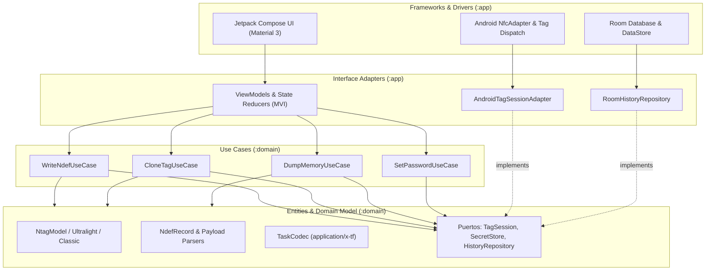

# Tag Forge — Suite Avanzada de Herramientas NFC para Android

<p align="center">
  
</p>

<p align="center">
  <strong>Aplicación nativa Android para lectura, escritura, clonación, auditoría de seguridad y automatización de tareas en tags NFC.</strong>
</p>

<p align="center">
  <a href="https://github.com/allanperezro123-beep/TagForge/releases"></a>
  <a href="https://developer.android.com/about/versions/14"></a>
  <a href="https://kotlinlang.org"></a>
  <a href="https://developer.android.com/jetpack/compose"></a>
  <a href="https://adoptium.net/"></a>
</p>

---

## 📌 Visión General

**Tag Forge** es una herramienta profesional de ingeniería y gestión NFC desarrollada por **Blue Code**. Diseñada para técnicos, integradores de sistemas y entusiastas del hardware, combina una experiencia de usuario refinada con capacidades de bajo nivel sobre transpondedores NFC (familias NXP NTAG213, NTAG215, NTAG216, MIFARE Ultralight, entre otras).

Se integra armónicamente como la aplicación compañera en campo para la plataforma web de gestión dinámica de enlaces [gestor-nfc-qr](https://github.com/allanperezro123-beep/gestor-nfc-qr).

---

## ✨ Características Principales

### 1. 🔍 Lectura e Inspección Profunda
- Detección automática de tecnologías (`NfcA`, `Ndef`, `MifareUltralight`).
- Identificación de fabricante, modelo de chip exacto, número de serie único (UID), capacidad de memoria utilizable y versión de silicio.
- Inspección estructurada de registros NDEF (URI, Texto plano, vCard, MIME personalizado, Smart Poster).

### 2. ✍️ Escritura y Codificación NDEF
- Asistente guiado de grabación con validación estricta de tamaño en memoria según el chip detectado.
- Creación de registros:
  - 🌐 Enlaces Web y URLs dinámicas de Blue Code.
  - 💬 WhatsApp Directo con mensaje preparado.
  - 📶 Configuración Wi-Fi (WPA2, WPA3 o redes abiertas).
  - 👤 Tarjeta de Contacto vCard.
  - 📞 Marcación telefónica y mensajes SMS.
- Verificación posterior a la escritura para garantizar la integridad de los datos grabados.

### 3. 🛠️ Herramientas de Especialista (Tools)
- **Volcado Completo de Memoria (Hex Dump):** Extracción página por página con visor hexadecimal y traducción ASCII en tiempo real. Exportable y copiable al portapapeles.
- **Clonador de Etiquetas:** Captura de imagen de origen y volcado en una nueva etiqueta destino (tanto NDEF como páginas en bruto compatibles).
- **Borrado Seguro:** Sobreescritura a ceros de las páginas de usuario con restauración de TLVs limpios de fábrica.
- **Generador de QR Wi-Fi:** Generación instantánea de códigos QR vectoriales para acceso de invitados.

### 4. 🛡️ Suite de Seguridad y Auditoría de Tags
- **Protección por Contraseña:** Configuración y verificación de llaves `PWD` (32 bits) y acuses de recibo `PACK` (16 bits) en chips NTAG21x.
- **Generador Criptográfico Seguro:** Generación aleatoria de contraseñas de grado industrial basada en `SecureRandom`.
- **Protección de Datos Locales:** 
  - Prevención de capturas de pantalla (`FLAG_SECURE`) en todas las interfaces de gestión de claves y contraseñas.
  - Marcado de portapapeles como contenido sensible para evitar fugas en teclados de terceros (Android 13+).
  - Redacción estricta de bytes secretos en registros y trazas de depuración.

### 5. ⚡ Motor de Automatización: Task Format v1
Tag Forge implementa su propia especificación de tareas compactas (`application/x-tf`) para desencadenar automatizaciones físicas sin requerir conexión continua a internet ni servicios pesados en segundo plano:
- Ajuste de perfiles de audio (silencio, vibración, normal).
- Control de volumen por canal (multimedia, llamadas, alarmas).
- Conmutación rápida de Wi-Fi, Bluetooth y Linterna.
- Disparo de temporizadores, alarmas y eventos de calendario.
- Peticiones Webhook HTTP (GET / POST) para integración con domótica e IoT.
- Ejecución segura con confirmación explícita del usuario y aislamiento de URLs maliciosas.

---

## 🏛️ Arquitectura del Proyecto (Clean Architecture & Hexagonal)

El proyecto sigue rigurosamente los principios de **Clean Architecture (Robert C. Martin)** y **Arquitectura Hexagonal (Puertos y Adaptadores)**. La regla de dependencias apunta estrictamente hacia el interior: el núcleo de dominio no tiene ninguna referencia a dependencias del SDK de Android (`android.*`), permitiendo pruebas unitarias instantáneas en la JVM.

### 📐 Diagrama de Dependencias y Flujo de Control



### 📂 Estructura de Módulos

```text
TagForge/
├── app/                                    # Frameworks & Interface Adapters (Android)
│   ├── src/main/java/com/tagforge/
│   │   ├── di/                             # Inyección de dependencias modular (AppContainer)
│   │   ├── nfc/                            # Implementación de puertos NFC (NfcAdapter, TagSession)
│   │   ├── data/                           # Persistencia local (Room, DataStore, Encriptación)
│   │   └── ui/                             # Vistas Jetpack Compose, ViewModels y Componentes M3
│   └── src/test/                           # Tests instrumentados y de integración
├── domain/                                 # Enterprise & Application Core (Kotlin Puro)
│   ├── src/main/kotlin/com/tagforge/domain/
│   │   ├── common/                         # Primitivas puras (Hex, Bytes, Outcome, Result)
│   │   ├── ndef/                           # Parsers y generadores de registros NDEF
│   │   ├── tag/                            # Modelos de silicio (NTAG213/215/216, MIFARE, ISO15693)
│   │   ├── security/                       # Algoritmos PWD/PACK, derivación y contraseñas
│   │   ├── task/                           # Motor de automatizaciones 'application/x-tf'
│   │   └── tools/                          # Casos de uso: lectura, volcado, clonación y borrado
│   └── src/test/                           # Tests unitarios 100% aislados en JVM
└── branding/                               # Identidad visual, previews y assets vectoriales
```

---

## 🛡️ Cumplimiento de Estándares Internacionales (Normas ISO)

Tag Forge ha sido estructurado respetando estrictamente estándares internacionales de calidad de software, seguridad física y telecomunicaciones:

* **ISO/IEC 25010 (Software Product Quality):**
  * *Mantenibilidad y Modularidad:* Desacoplamiento total entre lógica de negocio (`:domain`) y framework (`:app`).
  * *Testabilidad:* Más de 80 tests unitarios que se ejecutan en milisegundos en la JVM sin emuladores.
* **ISO/IEC 14443 & ISO/IEC 18092:** Soporte integral de señalización RF, anticolisión y encapsulado de tramas para proximidad (NFC-A, MIFARE Ultralight, NTAG).
* **ISO/IEC 15693:** Soporte para tarjetas y transpondedores de vecindad (Vicinity Cards - alcance extendido).
* **ISO/IEC 27001 (Seguridad de la Información & Privacidad):**
  * Bloqueo contra captura de pantalla (`FLAG_SECURE`) en interfaces de claves y volcados de memoria.
  * Marcado de portapapeles sensible en Android 13+ para evitar telemetría de teclados de terceros.
  * Protección criptográfica de credenciales y redacción de bytes sensibles en logs de ejecución.

---

## 📱 Descarga e Instalación (Distribución)

Puedes descargar el archivo `.apk` compilado y firmado directamente desde la sección de **Releases** de este repositorio:

👉 **[Descargar la última versión de Tag Forge (APK)](https://github.com/allanperezro123-beep/TagForge/releases)**

### Requisitos de Instalación
* Teléfono Android con versión **8.0 (Oreo) o superior** (API 26 a 35).
* Chip de hardware NFC activo.
* Para lectura con claves por defecto en MIFARE Classic se requiere controlador NFC compatible (NXP).

---

## 💻 Guía de Compilación para Desarrolladores

### Requisitos Previos
* **JDK 17** (ej. Eclipse Adoptium Temurin 17).
* Android Studio Ladybug / Koala o Android SDK Command Line Tools.

### Comandos de Compilación

1. **Clonar el repositorio:**
   ```bash
   git clone https://github.com/allanperezro123-beep/TagForge.git
   cd TagForge
   ```

2. **Ejecutar la suite completa de pruebas unitarias:**
   ```bash
   ./gradlew testDebugUnitTest :domain:test
   ```

3. **Compilar el APK de depuración (Debug):**
   ```bash
   ./gradlew :app:assembleDebug
   ```
   El APK generado quedará en `app/build/outputs/apk/debug/app-debug.apk`.

4. **Compilar y firmar la versión de Producción (Release):**
   * Configura tu archivo `keystore.properties` copiando la plantilla:
     ```bash
     copy keystore.properties.example keystore.properties
     ```
   * Completa las credenciales de tu almacén de claves (guía completa en [`dist/RELEASE.md`](dist/RELEASE.md)).
   * Compila y archiva la versión minificada con R8:
     ```bash
     ./gradlew :app:assembleRelease :app:archiveRelease
     ```

---

## 🎨 Paleta de Color y Diseño

Tag Forge implementa una identidad visual personalizada documentada en [`branding/palette.md`](branding/palette.md):
- **Deep Navy & Pure Cyan:** Tonos de precisión técnica y contraste accesible (mínimo 4.5:1 en texto y 3:1 en elementos interactivos).
- **Material You (Opt-in):** Opción en Ajustes para usuarios que prefieran heredar la paleta dinámica del sistema operativo Android.

---

## 📄 Licencia y Derechos

© 2026 **Blue Code**. Desarrollado con dedicación para soluciones NFC de alto rendimiento.  
Todos los derechos reservados.
